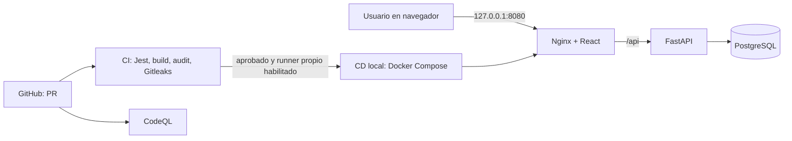

# Evidencias técnicas de StudyHub

**Corte:** 3 de noviembre de 2026. Los valores de Docker son una medición local puntual; pueden cambiar con la carga.

## Arquitectura y flujo



La API y PostgreSQL no publican puertos al host en `compose.deploy.yml`. Solo el frontend responde en loopback.

## 1. Pruebas y compilación

Comandos: `cd frontend`, `npm run test:coverage`, `npm run build`.

```text
Test Suites: 2 passed, 2 total
Tests:       6 passed, 6 total
apiError.ts:    100 % líneas / ramas / funciones
appointment.ts: 100 % líneas / ramas / funciones
vite v8.3.0: 37 módulos transformados; build terminado
```

Los casos comprueban horarios válidos, iguales, invertidos y mal formados; también detalles textuales del backend, errores Pydantic y fallos inesperados. Esta cobertura no representa toda la aplicación.

## 2. Despliegue y verificación HTTP

Comando: `./scripts/deploy-local.ps1`.

```text
studyhub-local-db-1        healthy
studyhub-local-backend-1   healthy
studyhub-local-frontend-1  healthy
StudyHub local operativo: http://127.0.0.1:8080/
GET /api/health  -> HTTP 200 {"status":"ok"}
GET /            -> HTTP 200
```

El navegador cargó `/dashboard` después de autenticar al usuario local de demostración y mostró cuatro grupos propios, siete sesiones próximas y cinco grupos disponibles. El proxy Nginx devolvió la cabecera `Content-Security-Policy` configurada.

## 3. Seguridad

```text
npm audit --omit=dev --audit-level=high
found 0 vulnerabilities

Búsqueda "Programación"       -> 1 grupo
Búsqueda "' OR 1=1 --"       -> 0 grupos
```

La primera prueba confirma que la búsqueda todavía funciona; la segunda comprueba que la entrada no altera la consulta SQL. El código usa un parámetro `:pattern` y envía el valor por separado. `.env` aparece en `git check-ignore` y no entra al commit. El backend exige `JWT_SECRET` largo y corre como usuario sin privilegios. Tras reconstruir las imágenes, `docker compose -f compose.deploy.yml exec -T backend id -u` devolvió `999`, y los tres contenedores volvieron a estado `healthy`.

## 4. FinOps local

| Contenedor | Memoria observada | Límite configurado |
|---|---:|---:|
| PostgreSQL | 62.33 MiB | 384 MiB |
| FastAPI | 77.62 MiB | 256 MiB |
| Nginx + React | 23.04 MiB | 128 MiB |
| **Total** | **162.99 MiB** | **768 MiB** |

El entorno se puede detener con `docker compose -f compose.deploy.yml down` para liberar CPU y memoria sin borrar el volumen. `down -v` elimina datos y solo debe usarse cuando se quiera reiniciar la base de demostración.

## 5. Evidencia en GitHub

- [Pull request #4](https://github.com/mar22266/StudyHub/pull/4): rama, commit de André Marroquin, revisión y **6/6 checks correctos**; sigue pendiente la aprobación de otro integrante exigida por la regla de `main`.
- [CI: ejecución del PR](https://github.com/mar22266/StudyHub/actions/runs/41649871109): Jest, TypeScript, imágenes, auditoría y Gitleaks.
- [CodeQL: ejecución del PR](https://github.com/mar22266/StudyHub/actions/runs/41649871107): análisis de TypeScript y Python.
- [Variables de Actions](https://github.com/mar22266/StudyHub/settings/variables/actions): `CI_NODE_VERSION=22`, `CI_PYTHON_VERSION=3.12`, `ENABLE_LOCAL_CD=false`.
- [Workflows](../.github/workflows/), [Compose](../compose.deploy.yml), [Jest](../frontend/tests/), [Dependabot](../.github/dependabot.yml), [plantilla PR](../.github/PULL_REQUEST_TEMPLATE.md).

El CD automático de GitHub permanecerá desactivado mientras no exista un runner propio. Su script local fue ejecutado y verificado; no hay despliegue público.
